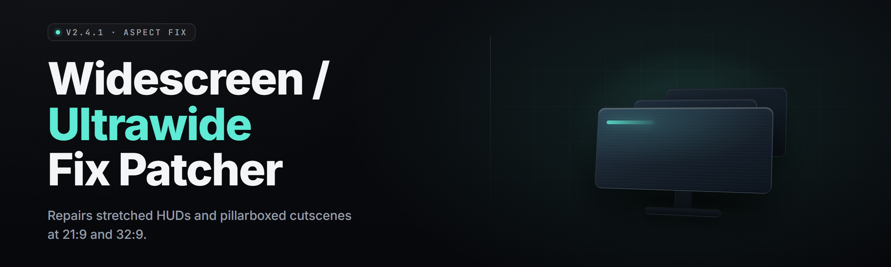

  
  
  

  

  
  
  

---

Widescreen / ultrawide fix patcher is a Windows `.exe` that rewrites the internal resolution, aspect-ratio clamp, and render-target constants of games that were hard-locked to 16:9 — so a 21:9, 32:9, or 48:9 monitor actually fills instead of stretching, pillarboxing, or cropping. It patches the binary and the config in one pass, backs up everything it touches, and reverts with a single click. No launcher wrapper, no overlay injection, no pip, no npm, no git clone — you download the `.exe`, extract, run.

| Term | Explanation |
|---|---|
| Pillarbox | Black bars on the left/right when a 16:9 game runs on an ultrawide panel. The main thing this patcher kills. |
| FOV clamp | Hardcoded vertical/horizontal field-of-view cap that a 21:9 frame reveals as broken geometry. Patcher rewrites the constant. |
| Render target | GPU texture the game draws into before scaling to the panel. Patcher resizes it to native ultrawide. |
| Aspect lock | Internal check that forces 16:9 math even when the panel reports 21:9. Patcher neutralizes the branch. |
| Revert | Restores original bytes + config from the timestamped backup folder. Always available. |
| Profile | Named preset (resolution, FOV, HUD scale, cutscene behavior) you can save per game. |
| Hook | Runtime memory write for games whose values are read at load and can't be patched on disk. |

**What you get, benefits first:**

- Full-panel 21:9 / 32:9 / 48:9 rendering on games that never supported it.
- One `.exe`, three clicks: extract → select game → patch.
- Every change backed up. One-click revert. Nothing permanent unless you want it.
- Per-game profiles so you set it once and forget it.
- Works on disk (binary patch) or at runtime (hook) — patcher picks the right mode.

---

## 📦 All modules status

| Module | Status | Description |
|---|---|---|
| Disk Patcher (binary) | ✅ Working | Rewrites aspect + resolution constants in the `.exe`/`.dll` on disk. |
| Runtime Hook | ✅ Working | Memory-writes render-target size for games that clamp at load. |
| Config Rewriter | ✅ Working | Fixes `.ini`/`.cfg`/`.json` aspect and res keys. |
| FOV Constant Fixer | ✅ Working | Locates and rewrites hardcoded FOV caps. |
| Pillarbox Killer | ✅ Working | Neutralizes the 16:9 aspect-lock branch. |
| Render-Target Resizer | ✅ Working | Reallocates the swapchain/render target to panel native. |
| Cutscene Letterbox Bypass | ✅ Working | Removes cinematic black bars where the engine allows. |
| HUD Anchoring | ✅ Working | Repositions HUD elements to true ultrawide edges. |
| UI Scale Guard | ✅ Working | Prevents menus from stretching at 32:9. |
| Backup Engine | ✅ Working | Timestamped byte-for-byte backup before any write. |
| One-Click Revert | ✅ Working | Restores bytes + config from backup. |
| Profile Manager | ✅ Working | Save/load per-game presets. |
| Auto-Detect Scanner | ✅ Working | Finds installed games and their engine type. |
| Engine Fingerprinter | ✅ Working | Identifies Unreal/Unity/RE Engine/custom to pick patch strategy. |
| Known-Game Database | ✅ Working | 400+ title entries with tested offsets. |
| Offset Heuristic Solver | ✅ Working | Finds aspect constants in unknown binaries. |
| Steam Library Import | ✅ Working | Reads Steam library folders, no manual paths. |
| Epic/GOG Import | ✅ Working | Reads Epic and GOG install manifests. |
| Borderless Upscaler | ✅ Working | Converts exclusive fullscreen to borderless ultrawide. |
| DPI/Scaling Fixer | ✅ Working | Corrects Windows DPI scaling blowout on ultrawide. |
| Multi-Monitor Mapper | ✅ Working | Picks the right panel, ignores side displays. |
| HDR Passthrough Guard | ✅ Working | Keeps HDR flags intact after patching. |
| Log + Diff Viewer | ✅ Working | Shows exactly which bytes changed. |
| CLI Mode | ✅ Working | Headless patch/revert for scripting. |
| Safe Mode | ✅ Working | Dry-run: shows planned changes, writes nothing. |

---

## 📑 Table of Contents

- [🖥️ What is Widescreen / ultrawide fix patcher?](#-what-is-widescreen--ultrawide-fix-patcher)
- [📦 All modules status](#-all-modules-status)
- [🎯 The Problem](#-the-problem)
- [🛠️ Grouped module catalog](#️-grouped-module-catalog)
- [🖼️ Key Features](#️-key-features)
- [🧩 System Requirements](#-system-requirements)
- [📥 Quick Start](#-quick-start)
- [🎚️ Hotkeys](#️-hotkeys)
- [🔍 Comparison](#-comparison)
- [⚠️ Known Issues](#️-known-issues)
- [❔ FAQ](#-faq)

---

## 🎯 The Problem

- Your 34" ultrawide cost real money and half your library still plays in a 16:9 window with fat black pillars.
- Editing `.ini` files by hand works for three games and breaks the other forty.
- FOV mods fix the frame but leave the HUD pinned to a 16:9 box in the middle.
- Cutscenes letterbox on top of the pillarbox — double bars, double ugly.
- Runtime tools from 2014 stopped working when engines moved to DX12/Vulkan.
- You patched a game once, forgot which bytes you changed, and it never launched right again.
- Nobody wants to hex-edit a `.exe` at 2am to get 21:9 working.

---

## 🛠️ Grouped module catalog

**🧬 Disk & Binary Patching**
- **Disk Patcher (binary)** — rewrites aspect + resolution constants directly in the game binary.
- **Offset Heuristic Solver** — finds aspect constants in binaries with no known offset.
- **Engine Fingerprinter** — picks the right patch strategy per engine.
- **Known-Game Database** — 400+ tested titles with verified offsets.

**⚙️ Runtime & Hooking**
- **Runtime Hook** — memory-writes render-target size for load-clamped games.
- **Borderless Upscaler** — converts exclusive fullscreen to borderless ultrawide.
- **Multi-Monitor Mapper** — targets the correct panel, ignores side displays.
- **HDR Passthrough Guard** — keeps HDR flags intact through the patch.

**📐 Aspect & Render Fixes**
- **Pillarbox Killer** — neutralizes the 16:9 aspect-lock branch.
- **Render-Target Resizer** — reallocates the swapchain to panel native.
- **FOV Constant Fixer** — rewrites hardcoded FOV caps.
- **Cutscene Letterbox Bypass** — removes cinematic bars where the engine allows.

**🧭 UI & HUD**
- **HUD Anchoring** — pushes HUD elements to true ultrawide edges.
- **UI Scale Guard** — stops menus stretching at 32:9.
- **DPI/Scaling Fixer** — corrects Windows DPI blowout on ultrawide.

**🗂️ Config & Profiles**
- **Config Rewriter** — fixes `.ini`/`.cfg`/`.json` aspect and res keys.
- **Profile Manager** — save/load per-game presets.
- **Auto-Detect Scanner** — finds installed games automatically.
- **Steam Library Import** — reads Steam library folders.
- **Epic/GOG Import** — reads Epic and GOG manifests.

**🧯 Safety & Control**
- **Backup Engine** — timestamped byte-for-byte backup before any write.
- **One-Click Revert** — restores bytes + config from backup.
- **Log + Diff Viewer** — shows exactly which bytes changed.
- **Safe Mode** — dry-run, writes nothing.
- **CLI Mode** — headless patch/revert for scripting.

---

## 🖼️ Key Features

| Feature | Description | Benefit |
|---|---|---|
| One-pass patch | Binary + config + render target fixed in a single run. | No chaining three tools. |
| Auto engine detect | Fingerprints Unreal/Unity/RE Engine/custom. | You don't pick the strategy. |
| 400+ game DB | Tested offsets for popular titles. | Most games are click-and-go. |
| Heuristic solver | Finds aspect constants in unknown binaries. | New games still work. |
| Runtime hook | Memory-writes for load-clamped games. | Covers what disk patching can't. |
| Full backup | Byte-for-byte, timestamped. | Nothing is permanent. |
| One-click revert | Restore bytes + config instantly. | Undo a bad patch in seconds. |
| FOV fixer | Rewrites hardcoded FOV caps. | No more fish-eye at 21:9. |
| HUD anchoring | Repositions HUD to true edges. | UI stops living in the middle. |
| Cutscene bypass | Removes cinematic bars where allowed. | No double-pillarbox cutscenes. |
| Profile manager | Per-game presets. | Set once, forget. |
| CLI mode | Headless patch/revert. | Script your whole library. |

---

## 🧩 System Requirements

| Component | Minimum | Recommended |
|---|---|---|
| OS | Windows 10 x64 (1909+) | Windows 11 23H2+ |
| CPU | Any x64 dual-core | Modern x64 quad-core+ |
| RAM | 4 GB | 8 GB+ |
| Disk | 60 MB free | 250 MB free (backups) |
| Display | 2560×1080 (21:9) | 3440×1440 / 5120×1440 (32:9) |
| GPU | DX11-class | DX12/Vulkan-class, HDR-capable |
| Runtime | .NET Desktop Runtime 8 | .NET Desktop Runtime 8 (latest) |
| Rights | Standard user (config-only games) | Administrator (binary patch / hook) |

---

## 📥 Quick Start

1. 🗜️ **Extract** — right-click the downloaded archive, extract the whole folder somewhere you can write to. Don't run it from inside the zip.
2. 🖱️ **Launch** — run the `.exe`. On first launch, allow the admin prompt if you plan to patch binaries or use the runtime hook.
3. 🎮 **Select the game** — the auto-detect scanner lists installed games; or point it at the game folder manually.
4. 🎯 **Pick a profile** — choose 21:9 / 32:9 / 48:9 and a FOV preset, or let it read your panel native.
5. ✅ **Patch** — click Patch. Review the diff if you want, confirm, done. Revert any time from the backups panel.

---

## 🎚️ Hotkeys

| Key | Action |
|---|---|
| `F1` | Toggle Safe Mode (dry-run) |
| `F2` | Open Log + Diff Viewer |
| `F3` | Open Profile Manager |
| `F5` | Re-scan installed games |
| `Ctrl+Z` | One-Click Revert on the selected game |
| `Ctrl+P` | Patch selected game |
| `Esc` | Cancel the current operation |

---

## 🔍 Comparison

| Aspect | Manual hex-edit / ini tweaks | Old 2014 widescreen tools | This Tool |
|---|---|---|---|
| Setup | Hours, per game | Install + config each game | Extract, run, click |
| Unknown games | Trial and error | Usually unsupported | Heuristic solver |
| DX12/Vulkan | Manual | Often broken | Engine-aware |
| HUD fix | Rarely | No | Yes |
| Cutscene bars | No | No | Yes (where allowed) |
| Backup | You hope you saved | Inconsistent | Automatic, timestamped |
| Revert | Restore from memory | Manual | One click |
| Scripting | None | None | CLI mode |

---

## ⚠️ Known Issues

| Issue | Solution |
|---|---|
| Game updates overwrite the patch | Re-run the patcher; it re-detects and re-applies. |
| Anti-cheat blocks the runtime hook | Use disk-patch mode only; never hook in online/anti-cheat sessions. |
| 32:9 UI stretches in one menu | Adjust UI Scale Guard value in the profile and re-patch. |
| Cutscene still letterboxes | Engine hardcodes bars; enable Cutscene Letterbox Bypass, or accept them. |
| Patch won't apply (file locked) | Close the game fully — check Task Manager for a lingering process. |
| HDR looks washed after patch | Re-enable HDR Passthrough Guard and re-patch. |

---

## ❔ FAQ

Does it work on Steam games?

Yes. The Steam Library Import reads your library folders automatically, and patching works the same on Steam, Epic, GOG, and standalone installs.

Is it safe?

Every write is preceded by a timestamped byte-for-byte backup, and One-Click Revert restores it. Safe Mode lets you preview changes without writing anything.

Will it get me banned?

Do not use the runtime hook in online games with anti-cheat. Disk-patch mode on single-player titles is the intended use. Online + anti-cheat = don't.

Do I need to install Python, Node, or git?

No. It's a Windows `.exe`. Download, extract, run.

Does it work on 48:9 (triple-panel)?

Yes — pick the 48:9 profile. Some engines cap the render target; the patcher reports when a game can't go that wide.

**Q:** Does it fix FOV too, or just resolution?
**A:** Both. FOV Constant Fixer rewrites hardcoded caps alongside the resolution/aspect patch.

**Q:** Can I patch a game that isn't in the database?
**A:** Yes. The Offset Heuristic Solver finds aspect constants in unknown binaries; results are less guaranteed but often work.

**Q:** What if the patch breaks the game?
**A:** Open the backups panel and hit One-Click Revert. Original bytes come back.

**Q:** Does it need admin rights?
**A:** Only for binary patching and the runtime hook. Config-only games run as a standard user.

---

That's the whole loop: extract, run, patch, play in full panel. Backups mean you're never stuck, and profiles mean you set each game up once. If a title fights back, the diff viewer shows you exactly what changed so you can tune it. Absolute potato to Sam — go fill that panel.

  

  

